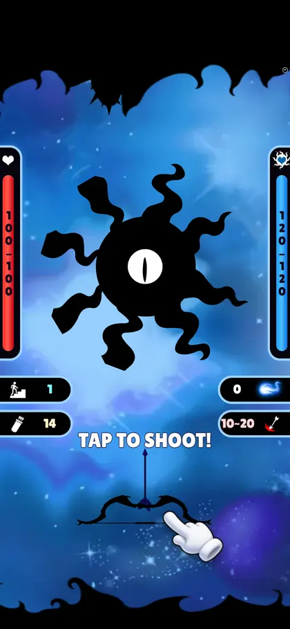
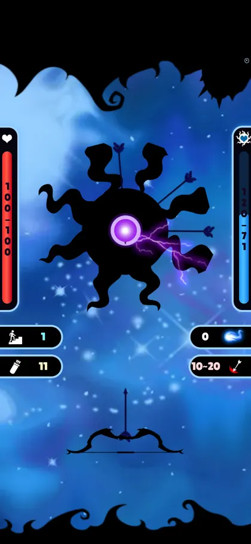
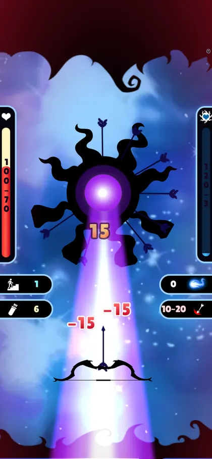
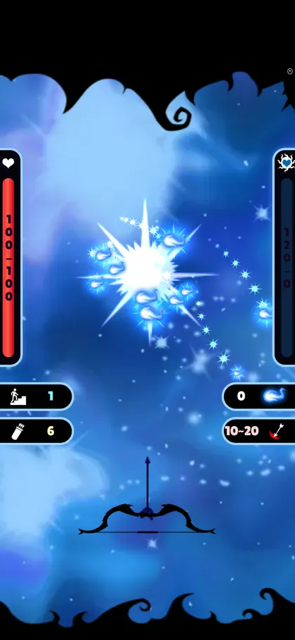
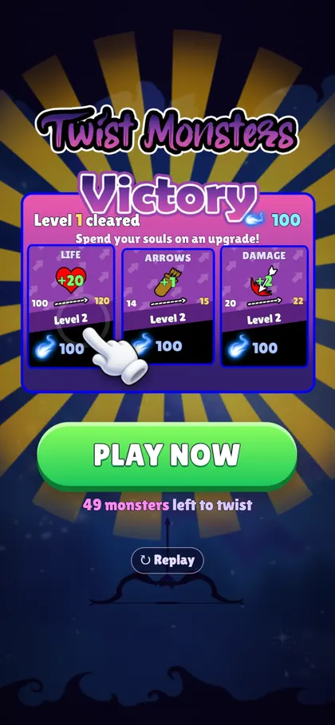
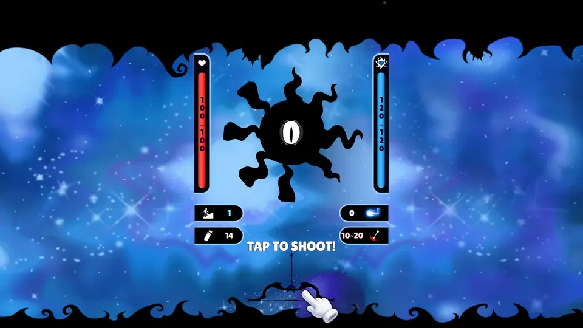

# Twist Monsters

A mobile-first **HTML5 playable ad** for *Twist Monsters*, an arrow-shooting monster game I made in Unity in 2019. In about 20 seconds the player shoots arrows into a spinning shadow monster, survives its energy laser, collects the souls it drops and spends them on a first upgrade. The **PLAY NOW** call to action sends the player to the store to fight the other 49 monsters.

This is a port, not a remake. The sprites, sounds, positions, speeds and animation timings come from the original Unity project, re-implemented in **TypeScript + Three.js** on a hand-written 2D layer. The production build is one self-contained 1.3 MB HTML file that makes no network requests.

<p align="center">
  
  
  
  
  
</p>
<p align="center">
  
</p>

## Live Demo

**▶ Play it: https://andersonigarashi.github.io/twistMonsters/**

Every push to `main` runs `.github/workflows/pages.yml`, which builds the playable and publishes it to GitHub Pages with the showcase page in `pages/index.html` (a phone frame on desktop, full screen on phones). The raw playable is served as `play.html`.

| URL parameter | Effect |
| --- | --- |
| `?sound=0` | Starts muted |
| `?cta=INSTALL` | Overrides the CTA label (A/B test hook) |
| `?dpr=1` | Caps the render pixel ratio |
| `?dev=1` | Shows FPS, worst frame, draw calls and pixel ratio |

## Gameplay

```
FIRST TAP ─▶ HITS ─▶ ENERGY CHARGE ─▶ LASER ─▶ MONSTER BURSTS ─▶ SOULS ─▶ UPGRADE ─▶ PLAY NOW
```

1. **The first tap is the game.** There is no title screen. The monster is already spinning at load, and a tutorial hand on the bow with "TAP TO SHOOT!" appears within a second. Press draws the bow (the original's `ArchReadyToShoot` sprite) and release fires.
2. **Twist timing.** Arrows stick in the monster and turn with it. An arrow that reaches a spot where another arrow is already stuck splits into two pieces that tumble away. That is the skill in the original game, and the reason tapping without looking doesn't win.
3. **The monster fights back.** After the first hit, an energy ball swells in its eye while lightning crackles around it. Then a laser blasts the bow and hits the player four times. Killing the monster during the charge cancels the attack.
4. **Payout.** The monster spins faster, shrinks and bursts. Its stuck arrows are knocked loose and ten souls swirl into the souls counter.
5. **End card.** The Victory panel offers the original game's three level-2 upgrades (Life +20, Arrows +1, Damage +2). The souls just won buy exactly one, the other two lock, and "49 monsters left to twist" points at the store.

**Always winnable, never fake.** The monster dies only when its life reaches zero. If the quiver runs dry, it refills with "+5 ARROWS" (the original offered a continue here), and the laser can never take the player's last point of life. The fight can't end in a dead state.

## What came from the Unity project

The Unity 2019.4 project (`level.unity`, about 4,700 lines of `gameModeController.cs` and 30 more scripts) was read rather than guessed:

| Original | In the playable |
| --- | --- |
| `GameObject_monster` at y 0.95, `speedRot` 80°/s | Same position and spin |
| `MonstroLVL1-3-5`: 8 `spriteTentaculo` transforms | Same positions, rotations and scale; each tentacle starts its 7-frame loop at a different frame |
| `eyeMonsterCode`: blink for 0.6 s every 3.6 s | Same, plus a blink on every hit |
| `arrowCode`: speed 25, arrow scale 0.2 × (1.1, 0.79) | Same speed and size |
| `attackRayMonster`: 6 bolt slots, ball grows 0.2 → 1, laser at scale 3, 4 damage ticks 0.3 s apart | Same slots, offsets and tick timing; the charge is shorter for a 20-second ad |
| `soulSpawnCode`: souls pulse between scale 0.4 and 0.8, then home to `SoulFIMdirection` | Same pulse; they curve into the HUD's souls counter |
| `bdMonsters` / `bdUpgrades`: level 1 has 120 HP, upgrades cost 100 souls at level 2 | Same values |
| Background panning from x 11.7 to −10.1 | Smooth ping-pong pan, with the darkness at half speed for parallax |
| Animator clips at 12 fps | All sprite sheets play at 12 fps |

**Changed for the ad:** damage is 10–20 instead of 6–12, so the monster falls in about eight hits instead of fourteen, and the energy charge starts on the first hit so a typical player sees the laser.

**Asset pipeline.** `tools/buildAssets.mjs` converts the original PNGs and MP3s. PNGs become WebP. Long horizontal sprite strips (the laser was 5,010 px wide) are repacked into grids of at most 2,048 px, because many low-end phones can't use a texture wider than 4,096 px. The darkness frame, a full-screen PNG with an empty middle, is split into its top and bottom bands so the GPU never blends the transparent middle. Sounds are trimmed and converted to mono MP3. The 24 images and 14 sounds come to 523 KB.

**Font.** The original used Berlin Sans FB Demi, which can't be redistributed. The playable uses an OFL subset of Lilita One (6 KB).

## Performance

- **One draw call per texture.** Every sprite goes through `SpriteBatch`, an `InstancedMesh` with per-instance sheet frame and RGBA tint. Tentacles, stuck arrows, bolts, blood, sparks, souls and damage numbers are each a single draw call. A full frame is about 20 draw calls.
- **No allocation per frame.** Batches are immediate mode over preallocated typed arrays. Particles, souls and damage numbers come from fixed pools, and the tween engine removes finished entries in place.
- **Damage numbers from an atlas.** Digits are rendered once into a glyph atlas with the game font. No text is rasterised during play.
- **HTML only where it's cheap.** The HUD and end card are a handful of DOM elements sized in world units (`1em` = one game unit), so they scale with the game at any aspect ratio. Everything that animates in numbers is in WebGL.
- **Adaptive resolution.** The pixel ratio is capped at 2 and steps down when a device averages under about 42 fps.
- **Audio.** Web Audio buffers decoded up front. Nothing plays before the first touch, and audio suspends when the tab is hidden.

## Quality Assurance

`tools/playthrough.mjs` plays the whole ad in headless Chrome with puppeteer-core: it taps until the monster dies, opens the end card, buys an upgrade, presses the CTA and replays. It saves a screenshot at every beat and reports console errors, external requests and frame times. It can throttle the CPU through CDP to stand in for a weak phone.

`tools/layouts.mjs` screenshots the gameplay and the end card at 540×910, 9:19.5, 3:4 tablet, 1920×1080 desktop and landscape phone, and resizes live from portrait to landscape and back.

```bash
npm run dev                                   # in one terminal
node tools/playthrough.mjs http://localhost:5191/ 390x844 3 qa 6
node tools/layouts.mjs http://localhost:5191/ qa-layouts
```

## How It Was Built (AI Workflow)

I built this port with Claude Code, starting from my 2019 Unity project folder and one instruction: convert it into a playable ad with the same stack as my other playables (TypeScript, Three.js, Vite, one HTML file).

| Stage | Tool | What it did |
| --- | --- | --- |
| Reading the original | Claude Code + Python | Parsed `level.unity` and the sprite `.meta` files to recover every transform, sprite slice and animation rate, and read the C# scripts for the rules |
| Assets | Claude Code + sharp + ffmpeg | `tools/buildAssets.mjs`: WebP conversion, sprite-sheet repacking and audio trimming |
| Implementation | Claude Code | The TypeScript and GLSL in `src/`, one commit per milestone |
| QA | Claude Code + puppeteer-core | Scripted playthroughs and layout screenshots (see Quality Assurance) |

## Run Locally

```bash
npm install
npm run dev        # http://localhost:5173 (also on your LAN for phone testing)
npm run build      # dist/index.html, one self-contained file
```

## Project Structure

```
src/
  main.ts            boot, game loop, adaptive resolution, dev overlay
  config.ts          tuning (from the Unity scene) and URL parameters
  core/              Stage (renderer, camera, resize), Tween, asset loading
  gfx/               SpriteBatch, ParticleLayer, DamageNumbers
  game/              Game (flow), Monster, Bow, Attack, Souls, Background
  ui/                HUD, tutorial hand, end card, styles
  ads/AdBridge.ts    MRAID open / Google ExitApi for the CTA
tools/
  buildAssets.mjs    Unity PNG/MP3 to WebP sheets and mono MP3
  inlineSingleFile.ts  Vite plugin: one HTML file, no requests
  playthrough.mjs    scripted QA run
  layouts.mjs        aspect-ratio screenshots
pages/index.html     GitHub Pages showcase
```

## License

Code: MIT. The art and sounds come from the original 2019 game and are included for this demo.
